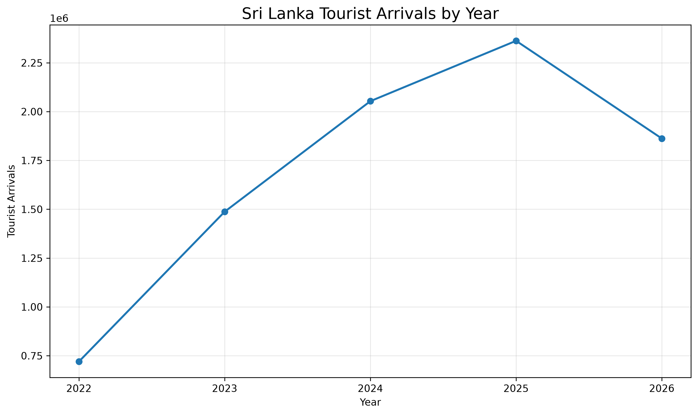
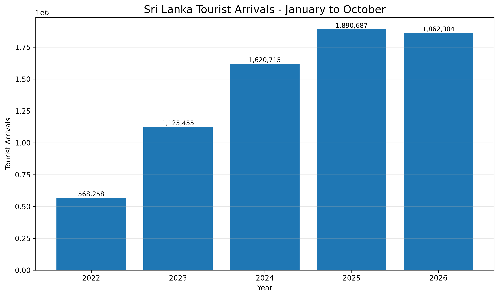
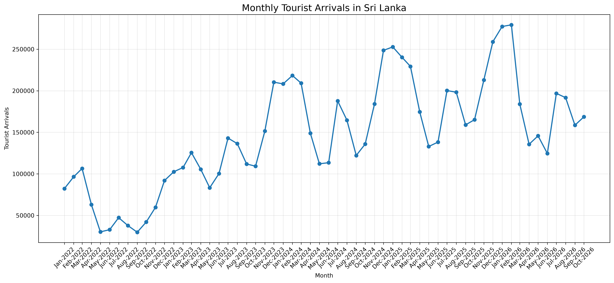
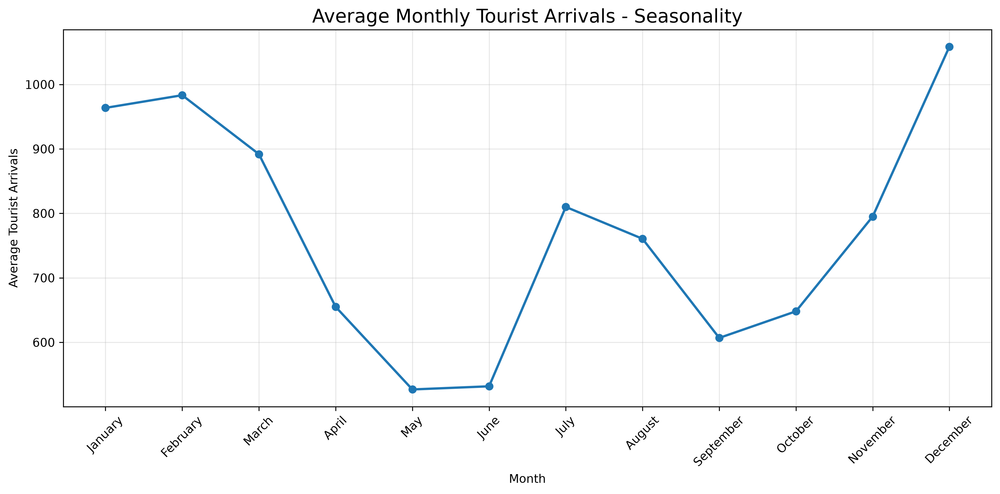
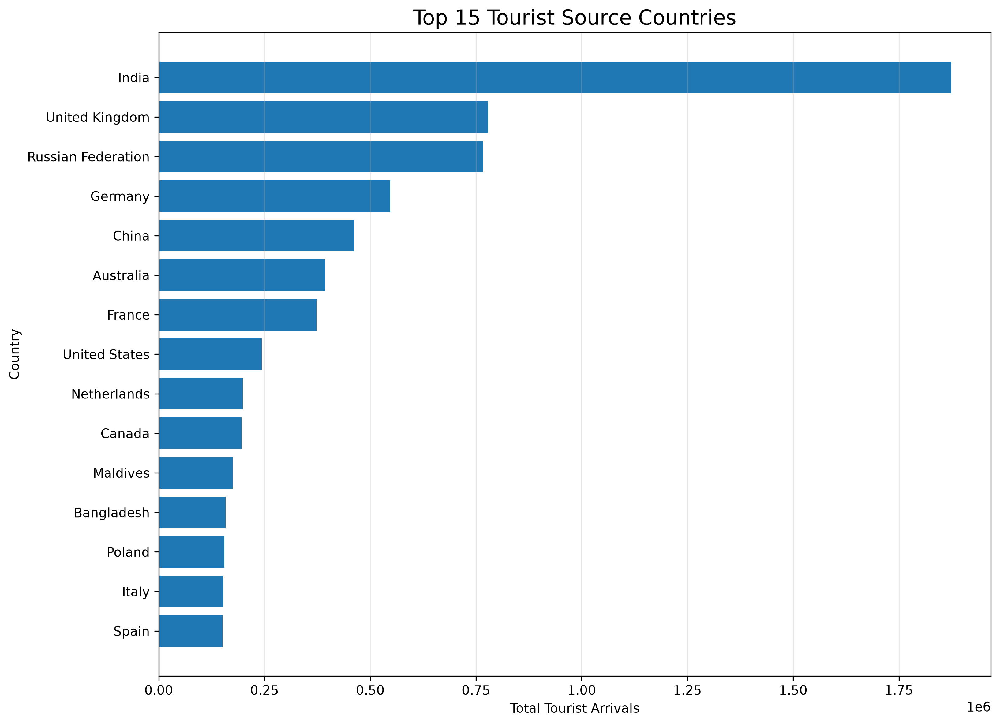
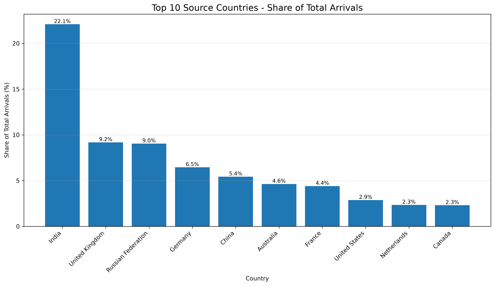
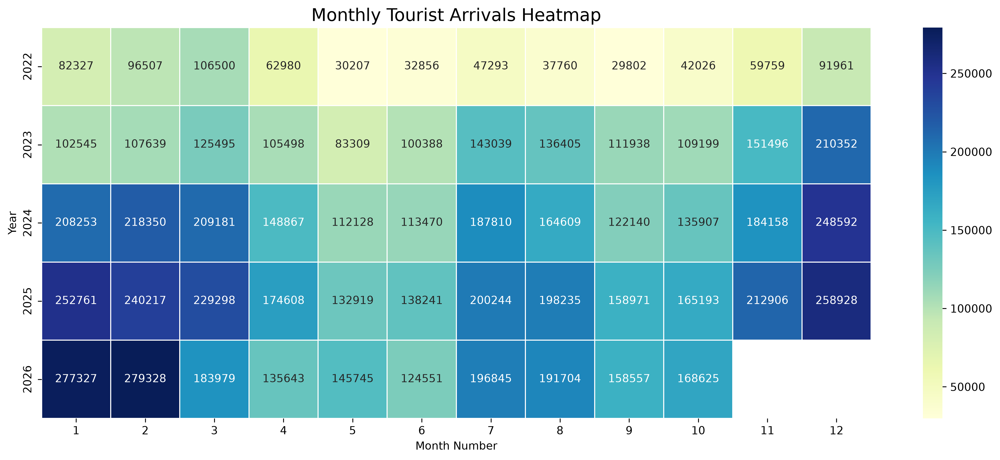
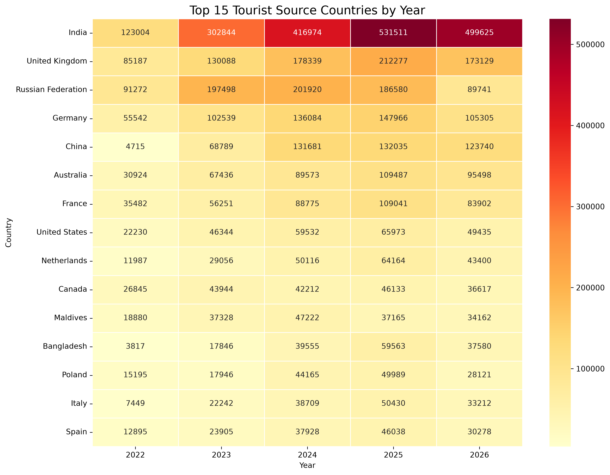
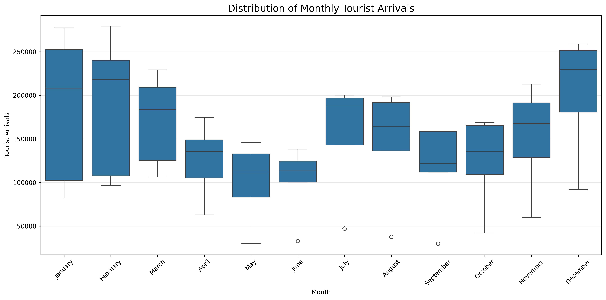
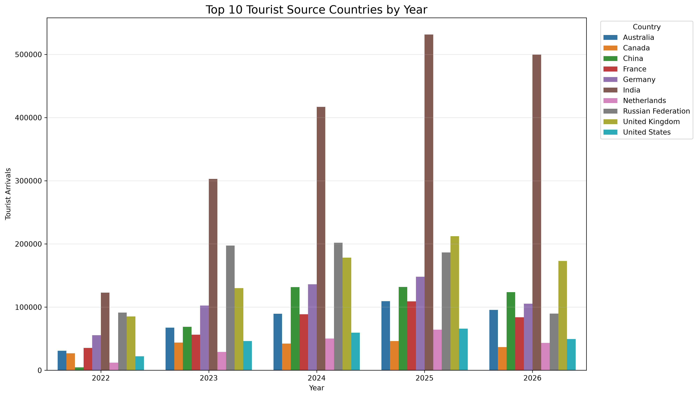

# Sri Lanka Tourism Analytics

An end-to-end data analytics project exploring tourist arrivals to Sri Lanka by year, month, season, and source country. The project uses Python, SQL, statistical analysis, and data visualization to turn monthly arrival data into reusable insights.

## Project highlights

- **Coverage:** January 2022 to October 2026
- **Main metric:** monthly tourist arrivals
- **Analysis dimensions:** year, month, seasonality, and source country
- **Methods:** data inspection, cleaning, exploratory analysis, statistical analysis, SQL analysis, and visualization
- **Current-year caveat:** 2026 contains January–October data only and should be compared with January–October periods from earlier years

## Key findings

1. Annual arrivals increased from **719,978 in 2022** to **2,362,521 in 2025**, showing a strong post-2022 recovery.
2. January–October arrivals reached **1,862,304 in 2026**, compared with **1,890,687 in 2025** for the same period.
3. Monthly arrivals show clear recurring seasonal peaks, especially around the late-year and early-year travel period.
4. India is the largest source market in the combined period, with **1,873,958 arrivals** and a **22.08% share**.
5. The United Kingdom and Russian Federation are the next largest source markets in the combined ranking.

## Visual analysis

### Annual recovery



### Like-for-like January–October comparison



### Monthly trend and seasonality





### Source-market concentration





### Heatmaps and distribution views









Interactive Plotly charts are available in [visualizations/plotly/](visualizations/plotly/).

## Repository structure

```text
01_Sri_Lanka_Tourism_Analytics/
├── data/
│   ├── raw/                         # Source Excel files
│   └── processed/                   # Cleaned and analytical datasets
├── notebooks/
│   ├── 01_Data_Inspection.ipynb
│   ├── 02_Data_Cleaning.ipynb
│   ├── 03_EDA.ipynb
│   ├── 04_Visualization.ipynb
│   ├── 05_Statistical_Analysis.ipynb
│   └── 06_SQL_Analysis.ipynb
├── reports/
│   └── ANALYSIS_REPORT.md
├── sql/                             # SQL analysis queries
├── visualizations/
│   ├── matplotlib/                  # Static charts
│   ├── plotly/                      # Interactive HTML charts
│   └── seaborn/                     # Heatmaps and statistical plots
└── README.md
```

## Analysis workflow

1. Inspect the raw tourism-arrival workbooks.
2. Clean and standardize country and date fields.
3. Explore annual, monthly, seasonal, and country-level patterns.
4. Run statistical analysis to examine growth, volatility, contribution, and trends.
5. Run SQL queries for reusable business summaries.
6. Generate static and interactive visualizations.
7. Review the conclusions in [reports/ANALYSIS_REPORT.md](reports/ANALYSIS_REPORT.md).

## Reproducing the analysis

Open the notebooks in order from `01_Data_Inspection.ipynb` through `06_SQL_Analysis.ipynb`. Update `PROJECT_ROOT` in the notebooks if the repository is moved to another directory.

The Plotly outputs are stored as HTML files in [visualizations/plotly/](visualizations/plotly/) and can be opened directly in a browser.

## Important interpretation note

2026 is a partial year with data through October. Full-year 2026 should not be compared directly with complete years. Use January–October comparisons for current-year reporting.

## Tools

Python · pandas · NumPy · Matplotlib · Seaborn · Plotly · SQL · Jupyter


