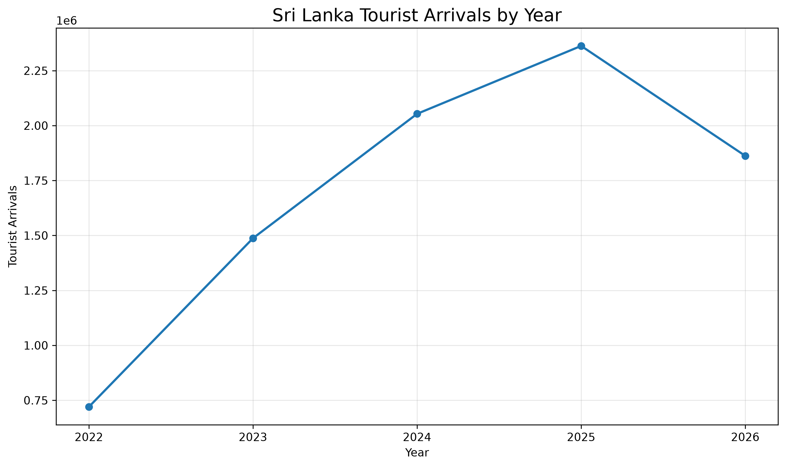
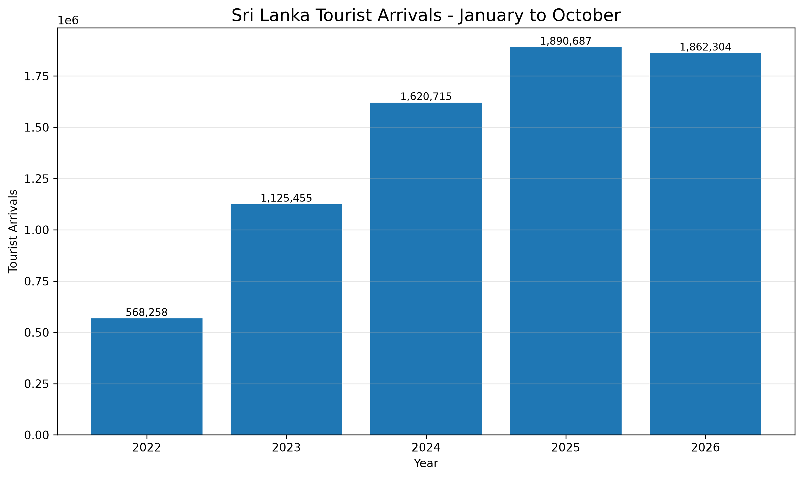
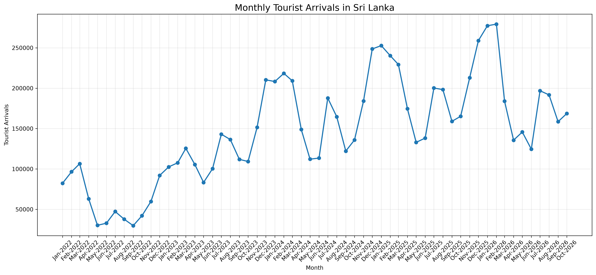
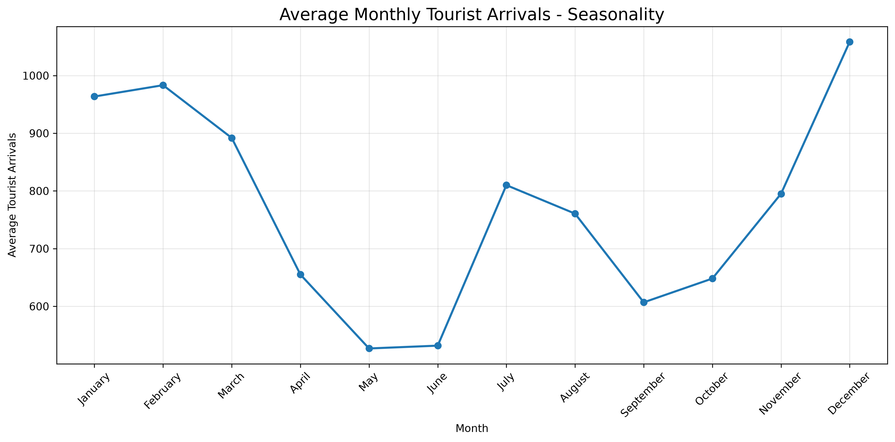
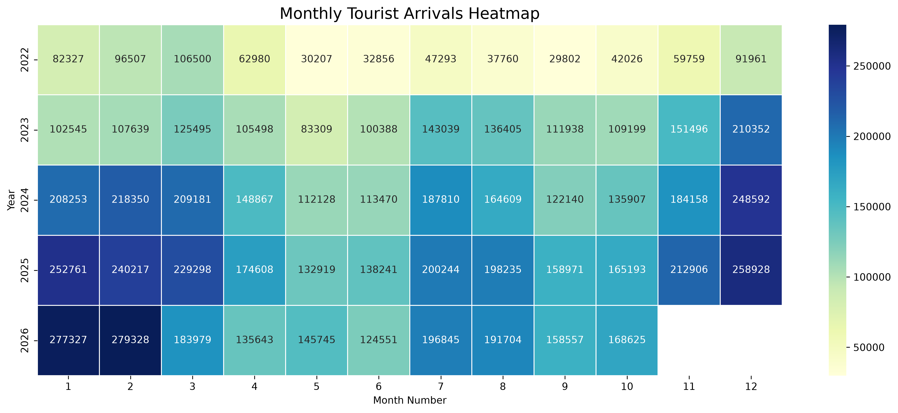
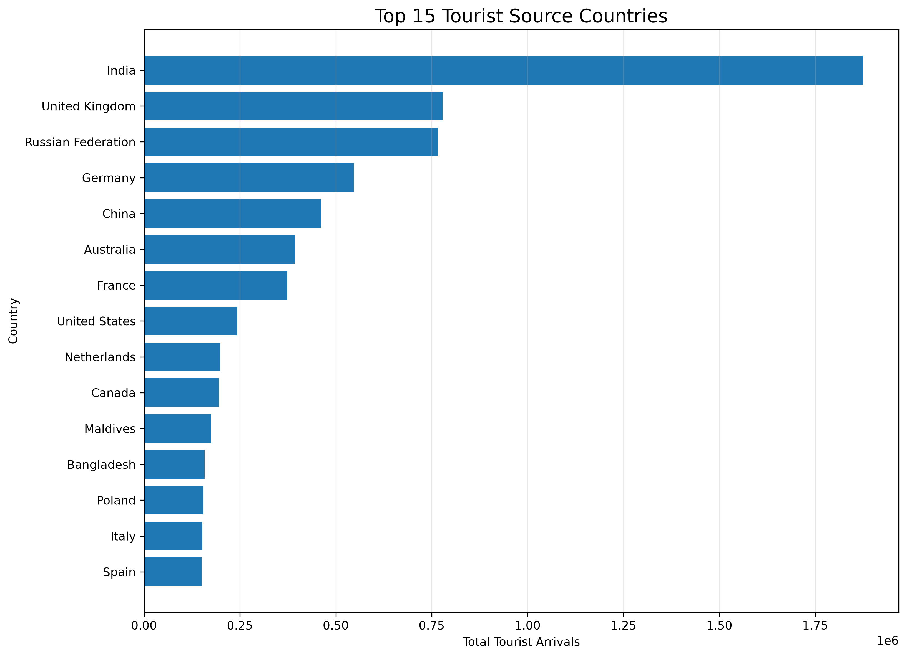
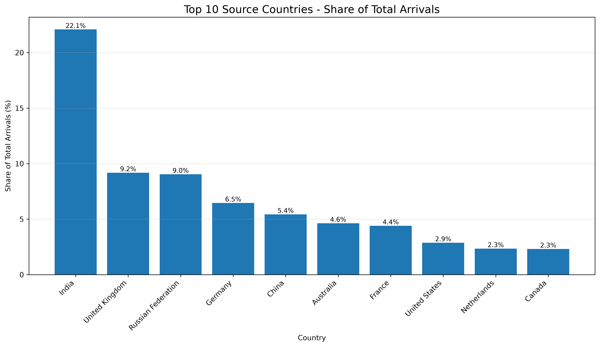

# Sri Lanka Tourism Analysis Report

## Executive summary

This project analyzes monthly tourist arrivals to Sri Lanka from January 2022 through October 2026. The analysis covers recovery over time, like-for-like current-year performance, seasonality, source-market concentration, country growth, and monthly variability.

## Main findings

### Recovery trend

Annual arrivals rose from 719,978 in 2022 to 2,362,521 in 2025. The annual trend chart shows a sustained recovery across the complete years in the dataset.

### Current-year performance

January–October 2026 recorded 1,862,304 arrivals, compared with 1,890,687 during January–October 2025. This is the correct comparison because 2026 does not contain November or December data.

### Seasonality

Monthly arrivals vary substantially across the year. The monthly trend, seasonality chart, and year-month heatmap help identify recurring high- and low-demand periods that can support campaign planning and capacity management.

### Source markets

India is the largest source market in the combined period, contributing 1,873,958 arrivals and 22.08% of the total. The United Kingdom and Russian Federation follow the leading market in the source-country ranking.

## Questions answered

- How did arrivals change from 2022 to 2025?
- How does January–October 2026 compare with the same period in earlier years?
- Which months show recurring seasonal peaks?
- Which countries contribute the largest number of visitors?
- How concentrated is the source-market mix?
- Which countries show the strongest changes across the analysis period?

## Analytical outputs

- Cleaned arrival data in `data/processed/`
- Exploratory summaries in `data/processed/eda/`
- SQL result tables in `data/processed/sql/`
- Statistical result tables in `data/processed/statistics/`
- Static charts in `visualizations/matplotlib/` and `visualizations/seaborn/`
- Interactive charts in `visualizations/plotly/`

## Limitations

- 2026 is partial-year data through October.
- Arrival totals describe visitor volume but do not measure spend, length of stay, satisfaction, or regional distribution within Sri Lanka.
- Source-workbook definitions and revisions should be checked before using the results for official reporting.

## Recommended next steps

- Add tourism revenue, hotel occupancy, and length-of-stay measures.
- Add airport, province, or destination-level detail where available.
- Refresh the 2026 comparison after November and December data are available.
- Add a forecasting model after validating the seasonal pattern over a longer time period.
